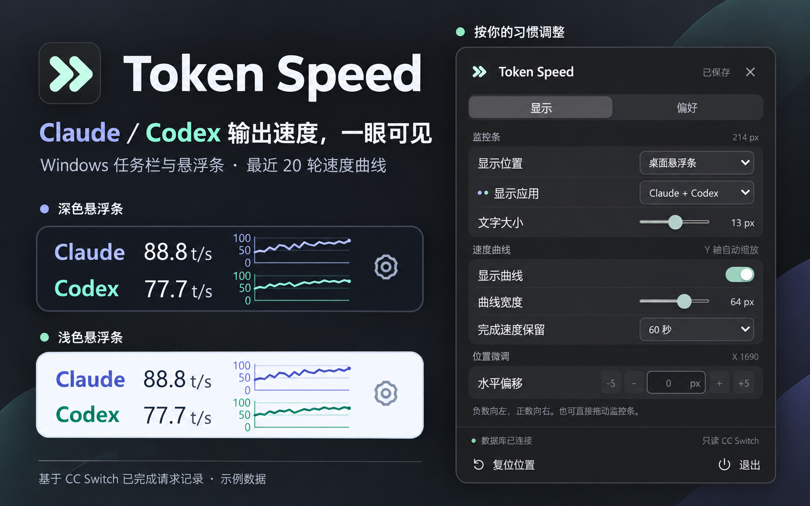
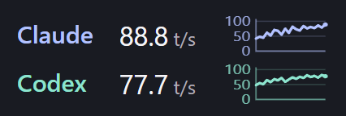
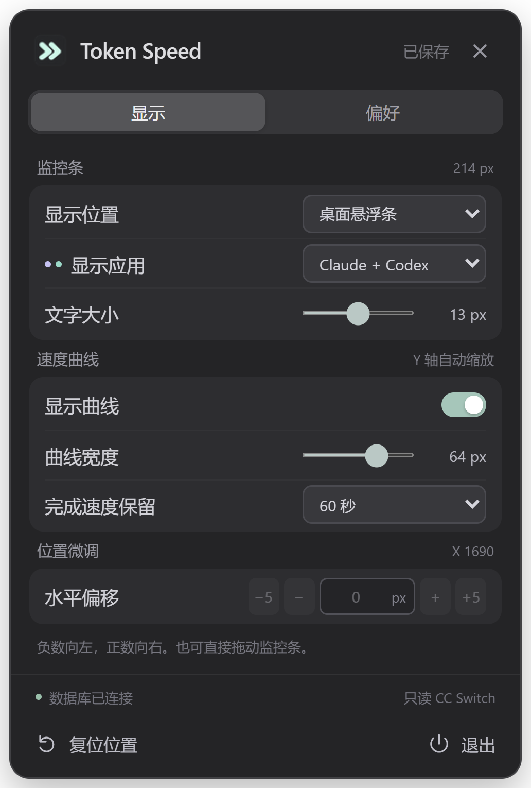
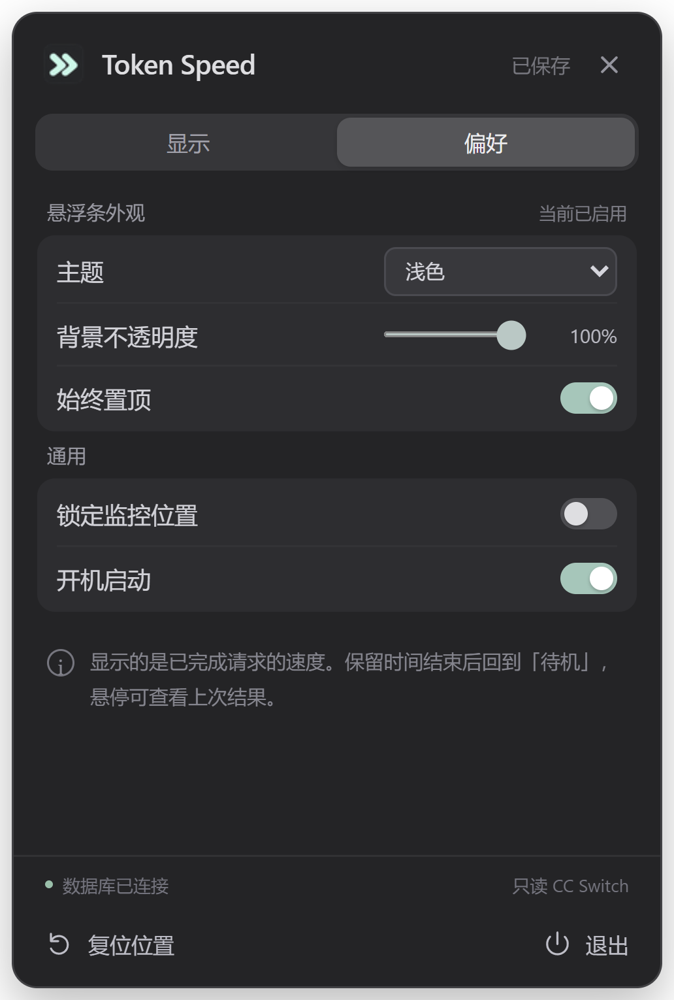

<p align="center">
  
</p>

<h1 align="center">Token Speed</h1>

<p align="center"><strong>把 Claude / Codex 的输出速度与当前会话内容，放到 Windows 任务栏。</strong></p>

<p align="center">
  <a href="https://github.com/Wang-YingGang/token_speed/releases/latest">下载最新版</a> ·
  <a href="#产品截图">产品截图</a> ·
  <a href="#三步开始使用">开始使用</a>
</p>



Token Speed 是一款 Windows 桌面小工具：在任务栏或桌面悬浮条中同时显示 **Claude / Codex 最近完成请求的速度、最近 20 轮速度曲线，以及当前会话的项目名和最新输出**。切换应用时，也能直接看见 AI 最新回复或工具执行结果。

速度从 **CC Switch 的本地用量数据库**只读获取；会话内容直接读取 Codex / Claude 的本地日志，无需配置 Hook。两种数据独立读取，没有 CC Switch 数据库时仍可显示会话输出。

> **速度在请求完成后更新。** `t/s` 表示每秒输出的 token 数。显示保留一段时间后会回到“待机”，鼠标悬停仍可查看上次结果。

## 下载

前往 **[Releases 下载最新版](https://github.com/Wang-YingGang/token_speed/releases/latest)**，选择适合的 Windows x64 文件：

| 文件 | 使用方式 |
| --- | --- |
| `Token-Speed_*_windows-x64-setup.exe` | 安装版，运行安装程序后启动 Token Speed。 |
| `Token-Speed_*_windows-x64-portable.zip` | 便携版，解压后运行 `token-speed.exe`。 |
| `SHA256SUMS.txt` | 安装包和便携版的 SHA256 校验值。 |

## 三步开始使用

1. **准备数据**：使用 CC Switch，并让 Claude 或 Codex 产生成功的请求用量记录。默认数据库位置为 `%USERPROFILE%\.cc-switch\cc-switch.db`。
2. **启动 Token Speed**：运行安装版或便携版。默认在主任务栏通知区域左侧显示 Claude / Codex 监控条，托盘中也会出现应用图标。
3. **开始任务**：会话日志写入后，项目名和最新内容直接出现在速度右侧。完成请求后更新速度与曲线。单击监控条或托盘图标打开设置，可调整显示方式、应用和会话预览宽度。

## 直接查看会话输出

会话内容与速度显示在同一个监控条中，每个应用各占一行，不另开会话窗口：

```text
Claude  88.8 t/s  [曲线]  myproject    正在检查配置加载逻辑…
Codex   77.7 t/s  [曲线]  token_speed  测试已通过，正在整理结果…
```

- 显示当前项目和最新回复或工具结果；长文本自动横向滚动，悬停时暂停。
- 同一应用有多个运行会话时，每 8 秒轮播；悬停暂停轮播，也可在对应行用滚轮切换。项目名旁显示当前序号与会话数。
- 已完成会话的内容保留与速度相同的时间，之后显示“等待会话输出”。缺少明确事件的 Claude 会话按近期日志活动推断；长时间无更新的会话不持续计为运行中。
- 在“显示 → 会话输出”关闭预览，或将预览宽度调整为 120–360 px。默认预览宽度 220 px，双应用任务栏总宽度 370 px；关闭后恢复原来的 142 px。

**内容随完整消息记录更新，不保证逐字同步。** Codex 已验证运行中消息的追加；Claude 已验证历史日志格式，实际写入时机取决于客户端版本。默认只读取本地记录，忽略推理与系统内容。

## 产品截图

以下截图采集于 **2026-10-30**，展示 v0.6.0 原有的速度与设置布局，尚未包含新增会话输出区。速度与曲线使用固定示例数据；监控条已放大展示。

### 任务栏监控条

Claude 与 Codex 各占一行，同时显示完成速度与历史走势。关闭会话输出时宽度为 142 个逻辑像素。

<p align="center">
  
</p>

### 桌面悬浮条

监控条也可以放在桌面上，自由拖动，并按桌面配色选择深色或浅色背景。

<table>
  <tr><th>深色</th><th>浅色</th></tr>
  <tr>
    <td></td>
    <td></td>
  </tr>
</table>

### 设置

“显示”页调整监控位置、应用、字号和曲线；“偏好”页调整悬浮外观、置顶、位置锁定和开机启动。

<table>
  <tr><th>显示</th><th>偏好</th></tr>
  <tr>
    <td></td>
    <td></td>
  </tr>
</table>

## 可以怎样调整

| 功能 | 可调整内容 |
| --- | --- |
| 显示方式 | 主任务栏嵌入 / 桌面悬浮条。 |
| 显示屏幕 | 主显示器 / 其他显示器 / 所有显示器，并可选择最左侧或最右侧停靠。 |
| 应用 | 同时显示 Claude + Codex，或只显示其中一个；单应用模式隐藏应用名称。 |
| 速度曲线 | 各自最近 20 轮记录，从左到右由旧到新；Y 轴自动缩放；宽度 24–80 px，也可关闭。 |
| 会话输出 | 在速度右侧显示项目名与最新内容；预览宽度 120–360 px，可关闭；多会话轮播或滚轮切换。 |
| 文字和外观 | 字号 10–16 px；悬浮条支持深浅主题、30%–100% 背景不透明度和置顶。 |
| 速度保留时间 | 15 / 30 / 60 秒，默认 15 秒；过期后显示“待机”。 |
| 位置 | 拖动文字区移动；任务栏支持输入偏移与 ±1 / ±5 px 微调；支持锁定位置。 |
| 日常使用 | 自动保存设置与位置、开机启动、托盘显示 / 隐藏和退出。 |

单击监控条或托盘图标打开设置；按 `Esc`、单击关闭按钮或其他窗口收起设置。悬停监控条可查看上次速度、记录时间和模型。

## 速度和状态怎么读

**输出速度 = 输出 token 数 ÷ 生成耗时（秒）。** 优先用“请求总延迟 − 首 token 等待时间”计算生成耗时；数据不完整时，依次使用记录中的耗时字段或总延迟。

例如，一轮请求输出 800 个 token，总延迟 12 秒，首 token 等待 2 秒，显示速度就是 `800 ÷ (12 − 2) = 80 t/s`。曲线仅保留成功且有输出的请求记录。

| 显示状态 | 含义 |
| --- | --- |
| `88.8 t/s` 等数值 | 最近完成的一轮请求的输出速度，仍在保留时间内。 |
| `待机` | 正在等待新的完成记录；悬停仍可查看上次结果。 |
| `暂无` | 当前应用没有可显示的成功输出记录。 |
| `等待数据库` / `读取失败` | 尚未找到数据库，或当前数据库无法读取；可悬停设置页底部状态查看原因。 |

**速度区的“待机”不能判断会话是否正在运行。** 右侧会话输出独立读取本地记录，左侧仍显示已完成请求的速度，无法测量生成中的逐 token 速度。

## 数据与配置

程序以只读方式打开 CC Switch 数据库，不修改其中的用量记录。应用设置默认保存在 `%APPDATA%\TokenSpeed\settings.json`；旧设置自动补齐新增字段。悬浮条可以拖到任务栏区域，修改设置或重启后保持该位置；只有超出完整屏幕边界时才修正。开启“始终置顶”时，点击任务栏后仍保持悬浮条位于任务栏上方，恢复层级时不抢焦点。保存的屏幕不可用时会将悬浮窗口移回可见区域。

自定义路径可通过环境变量指定：

| 环境变量 | 用途 |
| --- | --- |
| `CC_SWITCH_DB` | 指定 CC Switch 用量数据库路径。 |
| `TOKEN_SPEED_SETTINGS` | 指定设置文件路径。 |
| `TOKEN_SPEED_EXE` | 为原生集成测试指定待测程序。 |
| `TOKEN_SPEED_CODEX_SESSIONS` | 指定 Codex 会话日志目录，默认 `%USERPROFILE%\.codex\sessions`。 |
| `TOKEN_SPEED_CLAUDE_PROJECTS` | 指定 Claude 会话日志目录，默认 `%USERPROFILE%\.claude\projects`。 |

例如，在 PowerShell 中指定其他数据库后启动便携版：

```powershell
$env:CC_SWITCH_DB = "D:\CCSwitch\cc-switch.db"
.\token-speed.exe
```

## 本地开发

项目基于 Rust + Tauri 2，前端使用原生 HTML / CSS / JavaScript。准备 Node.js、Rust 和 Windows 桌面构建环境后运行：

```powershell
npm ci
npm run dev
```

测试和打包：

```powershell
npm test
npm run build
```

构建产物位于 `src-tauri/target/release/token-speed.exe` 和 `src-tauri/target/release/bundle/nsis/`。

<details>
<summary>原生集成验证与截图更新</summary>

原生集成验证使用隔离的 WebView 配置目录、数据库副本和设置文件，覆盖真实窗口拖动、模式切换和重启恢复：

```powershell
python -m pip install --target integration/.deps -r requirements.txt
python prepare_integration_db.py
cargo build --manifest-path src-tauri/Cargo.toml --locked
npm run test:native
npm run test:sessions
npm run test:position
```

README 原始截图使用独立的示例数据库和配置，重新编译当前代码后可采集：

```powershell
cargo build --manifest-path src-tauri/Cargo.toml --locked
python scripts/capture-docs.py
```

截图写入 `docs/images/`，版本、采集时间和源码摘要记录在 `docs/images/capture.json`。展示图的制作说明见 [图片说明](docs/images/README.md)。

`integration/` 保存可重建的测试数据和 WebView 缓存，`src-tauri/target/` 保存构建产物，均不提交。临时调试文件放入已忽略的 `scratch/`、`tmp/` 或 `temp/` 目录。

图标源文件为 `assets/icon-source.png`，设计提示词见 `assets/icon-design.md`；运行 `python generate_icon.py` 重建图标。

</details>

<details>
<summary>自动发布</summary>

推送 `v*` 版本标签后，GitHub Actions 会校验版本、运行测试、构建 Windows x64 安装包，再发布到 Releases。附件包括安装包、便携版 ZIP 和 SHA256 校验文件。带预发布后缀的标签（如 `v0.7.0-beta.1`）会发布为 Pre-release。

发布前保持 `package.json`、`package-lock.json`、`src-tauri/Cargo.toml`、`src-tauri/Cargo.lock` 和 `src-tauri/tauri.conf.json` 中的应用版本一致，提交并推送后创建同版本标签：

```powershell
node scripts/validate-release.mjs v0.7.0
git tag -a v0.7.0 -m "Token Speed v0.7.0"
git push origin v0.7.0
```

失败后可在 Actions 页面重新运行，或手动运行 Release 工作流并填写已存在的版本标签。发布使用 GitHub 自动提供的仓库令牌，无需额外 Secret。

</details>

## 许可

[MIT](LICENSE)
